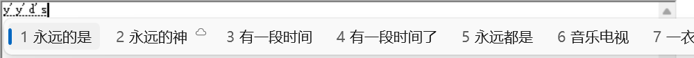

# PinyinFlux

给 Windows 自带的**微软拼音**接上百度、搜狗云词库。

不换输入法，没有额外的候选窗：云词像微软自己的云候选一样，出现在原生候选栏第 2 位，带云朵图标，选词、上屏和自学习仍由微软拼音完成。

## 特性

- **原生体验**：云词进入微软拼音自己的候选流程，不改动候选窗样式和快捷键。
- **简拼、混拼也能出词**：`yyds` → 永远的神，`yuanshenqd` → 原神启动，`zhrmghg` → 中华人民共和国。
- **不打扰本地输入**：等待云结果时不预留空位，本地候选的编号不会跳动；无结果、超时、断网或与本地重复时候选完全不变。
- **少而准**：两个词库共同认可的词才会多给，排在后面的同音词不显示；常用词交给本地词库。
- **自动适配 Windows 版本**：按本机组件版本从微软公开符号服务器获取函数地址，读不出就停止，不会盲目打补丁。
- **隐私克制**：只把拼音发给你选择的词库，不发送正在输入的应用名或其他上下文；没有遥测。

## 系统要求

- Windows 10 2004 及以上或 Windows 11，x64（目前实际验证于 Windows 11 24H2，10.0.26100；其他版本依赖自动适配）
- 系统自带的“微软拼音”输入法，并在其设置“词库和自学习”中**开启云候选**
- 管理员权限（注入输入法宿主进程时需要确认一次 UAC）
- 首次运行需能访问 `msdl.microsoft.com`（下载约 10 MB 的微软公开符号，之后离线可用）

## 安装与使用

1. 从 [Releases](https://github.com/TIANLI0/PinyinFlux/releases) 下载 `PinyinFlux-Setup-<版本>-win-x64.exe` 并安装（按用户安装，无需管理员）。
2. 打开 PinyinFlux，在“概览”中启动；提示需要权限时点击“提权重启”并确认 UAC。
3. 看到“原生云候选钩子已就绪”后，在任意窗口用微软拼音输入，例如 `yyds`，停顿片刻即可看到第 2 位的云词。

在“云词库”页可以启用、停用百度和搜狗，并调整优先级。“设置 → 停用并还原”会撤销所有改动；在“Windows 设置 → 应用”中卸载也会自动还原。

## 常见问题

**看不到云词？** 先确认微软拼音的云候选开关已开启，再打开 `http://127.0.0.1:18765/status`：

| 现象 | 说明 |
| --- | --- |
| `nativeDenied` 大于 0 | 权限不足，请在 PinyinFlux 中点击“提权重启” |
| `nativeLayout` 含 `no symbols` 或 `incomplete` | 未能确认当前 Windows 版本的地址（多为首次运行无法下载微软符号）。联网后重启核心；仍不行请提交 Issue |
| `nativeReady` 为 1 但很少出现云词 | 正常现象：云词与本地候选重复时不显示，常用词通常本地已有 |

**会不会影响打字速度？** 不会。本地候选立即显示，云词最多等待 450 毫秒后才插入；网络异常时输入法行为与未安装时相同。

**Windows 更新后失效？** 核心启动时会按新版本重新获取地址。如果新版本改动了相关逻辑，PinyinFlux 会拒绝安装钩子并在状态中说明，此时输入法保持原样可用。

## 隐私

- 发往百度、搜狗的只有当前拼音串。
- 首次运行会从微软符号服务器下载与本机组件对应的公开 PDB。
- PinyinFlux 只在本机回环地址 `127.0.0.1:18765` 提供服务，不收集、不上传任何使用数据。日志默认关闭，开启后写入 `%LOCALAPPDATA%\PinyinFlux\core.log`，其中包含输入的拼音。

## 工作原理

PinyinFlux 由三部分组成：

- **核心**（`PinyinFluxCore.exe`）：本地服务，并发查询各词库、合并排序并缓存；向输入法宿主注入扩展。
- **扩展**（`PinyinFluxInject.dll`）：在 `ctfmon.exe` 中挂钩微软拼音的云候选流程，把云请求转到核心，并控制云占位何时出现。
- **设置界面**（`PinyinFlux.exe`，WinUI 3）。

详细设计、选词规则以及与微软原生流程的配合方式见 [云候选设计](docs/cloud-candidates.md)；构建、测试与诊断见 [开发说明](docs/development.md)。

## 免责声明

PinyinFlux 是独立的开源项目，与微软、百度、搜狗均无关联。它在运行时修改微软拼音进程的内存行为，并使用非公开的词库接口；这些都可能随厂商更新而失效。项目仍处于实验阶段，请自行评估风险后使用。

## 参与

欢迎提交 Issue 和 Pull Request，请先阅读 [贡献指南](CONTRIBUTING.md)。安全问题请按 [安全策略](SECURITY.md) 私下报告。

## 许可

[MIT](LICENSE)。使用的第三方组件及其许可见 [THIRD_PARTY_NOTICES.txt](THIRD_PARTY_NOTICES.txt)。
